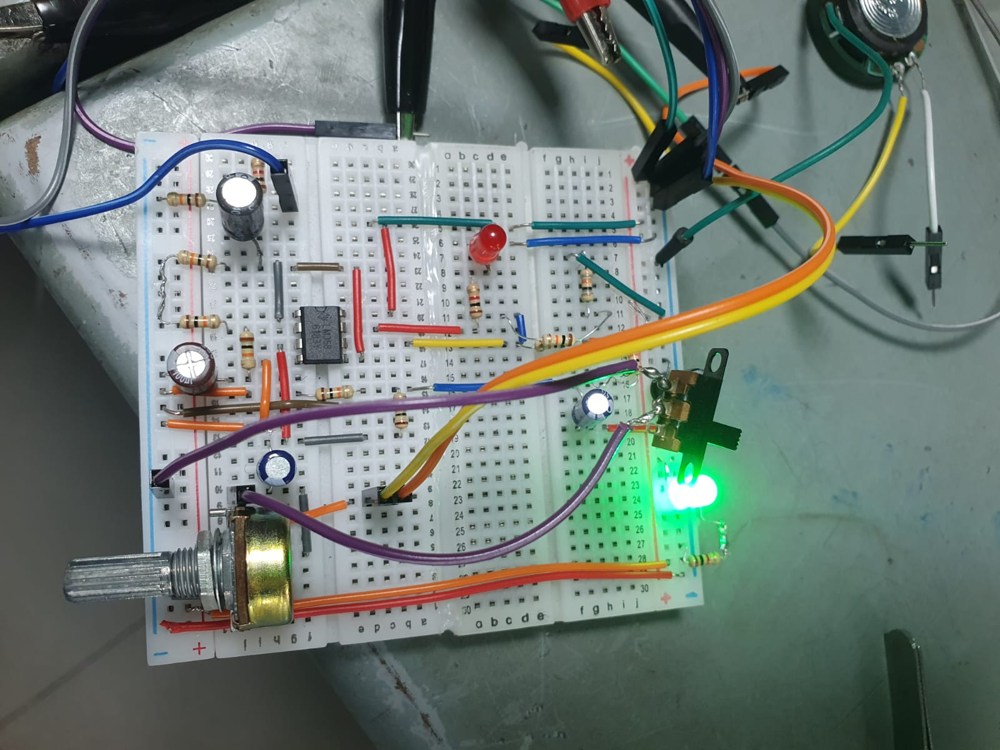
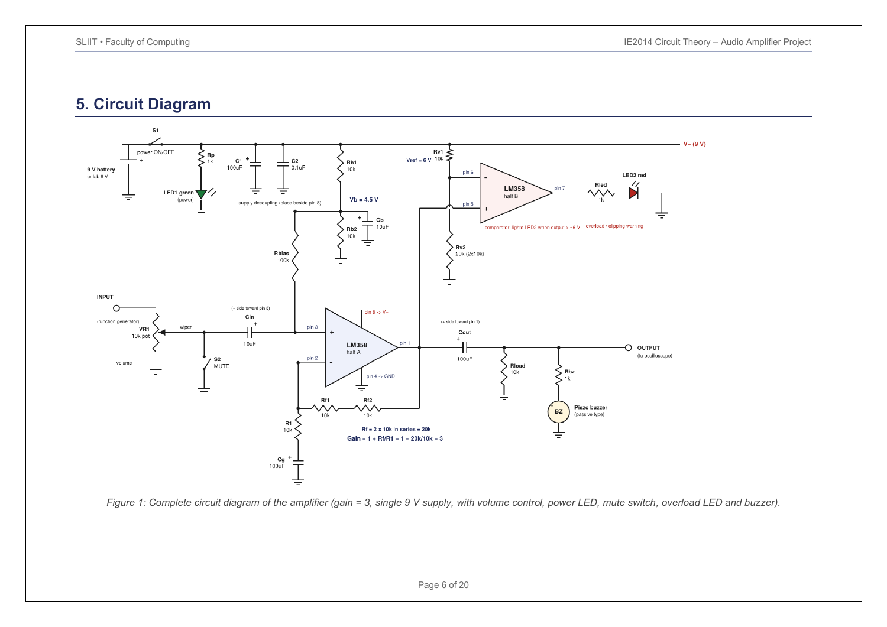
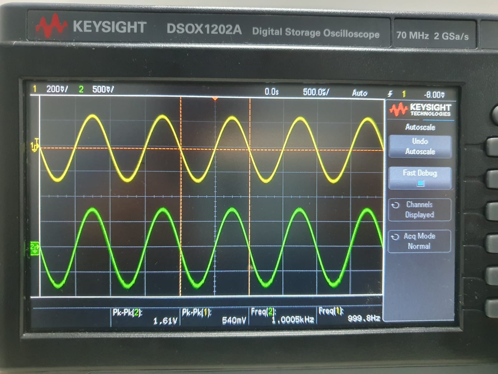
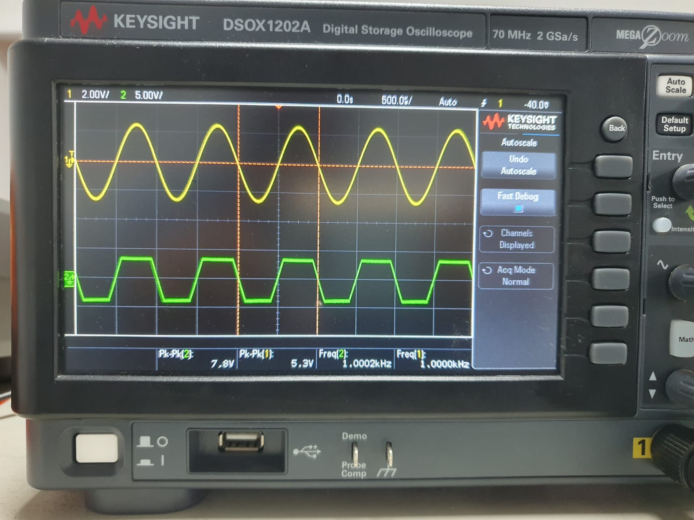

# LM358 Audio Amplifier

**A two-person Circuit Theory project: design, breadboard construction, and laboratory evaluation of a single-supply non-inverting amplifier.**

SLIIT · IE2014 Circuit Theory · Year 2, Semester 1 · Project dates: 23 September–7 October 2026

**Team:** Shakeeb M.A (Shakeeb Aduham) and Achchuthai A.
This repository presents joint project work. Individual task ownership is not specified in the report.

## Project overview

We designed and built an LM358 amplifier targeting a voltage gain of 3 from a single 9 V supply. The project connects feedback and biasing calculations with practical breadboard construction, waveform measurement, and investigation of output clipping.

The design includes an input volume potentiometer, mute switch, green power LED, and a red overload indicator using the second amplifier in the LM358 package. Feature implementation and verification status are distinguished below.

## Design

| Parameter | Design value |
| --- | --- |
| Amplifier | LM358, non-inverting configuration |
| Supply | Single 9 V DC supply |
| Target voltage gain | 3 V/V; accepted range 2.7–3.3 |
| Feedback resistance | 20 kΩ, using two 10 kΩ resistors in series |
| Gain-leg resistance | 10 kΩ |
| Nominal DC bias | 4.5 V from an equal-resistor divider |
| Volume control | 10 kΩ input potentiometer |
| Nominal laboratory input | 1 kHz sine wave, 0.5 Vpp |

The mid-band gain is **Av = 1 + Rf/R1 = 1 + 20 kΩ/10 kΩ = 3**. AC coupling separates the signal from the DC bias required for single-supply operation. See the cleaned project report for the component list and calculations.

## Laboratory evidence

| Evidence | Input | Output | Interpretation |
| --- | --- | --- | --- |
| Uploaded clean-waveform photograph | 0.540 Vpp, 999.8 Hz | 1.61 Vpp, 1.0005 kHz | Gain ≈ 2.98 V/V; approximately in phase |
| Operating point documented in the report | 0.504 Vpp | 1.54 Vpp | Gain ≈ 3.06 V/V |
| Uploaded clipping photograph | 5.3 Vpp, 1.0000 kHz | 7.8 Vpp, 1.0002 kHz | Output visibly clipped; not a linear-gain measurement |

The clean-waveform photograph gives **1.61 / 0.540 ≈ 2.98 V/V**, about **0.62%** below the target of 3. The separate report operating point gives **1.54 / 0.504 ≈ 3.056 V/V**, about **1.85%** above target. Both fall within the assignment tolerance; they are separate observations and should not be combined into one trial.

The clipping image confirms distortion at the photographed operating point. It does not establish the exact input level where clipping begins.

## Feature status and limitations

- **Voltage amplification:** demonstrated by oscilloscope measurements near 1 kHz.
- **Volume control:** implemented; variation in output amplitude is reported.
- **Power indicator:** green LED visibly illuminated in the prototype photograph.
- **Mute switch:** included in the design; no quantitative mute measurement is supplied.
- **Overload indicator:** included using the second LM358 section; its switching threshold was not fully verified.
- **Audible output:** the report states that the passive buzzer did not produce audible sound. A speaker is visible in the supplied photographs, but successful speaker operation is not established by the evidence.
- **Frequency response:** no complete measured frequency sweep or confirmed −3 dB bandwidth is available. Estimated response values in the original report are not presented here as verified measurements.

This is an educational voltage-amplifier prototype. The evidence does not establish a completed loudspeaker power amplifier or full audio-band performance.

## Equipment

- Keysight DSOX1202A digital storage oscilloscope
- Tektronix AFG1022 function generator
- Tenma 72-7245 laboratory DC power supply, photographed at 9.0 V
- Breadboard, jumper wires, LM358, passive components, LEDs, potentiometer, and switches

## Repository contents

- [Project report (PDF)](docs/LM358-Audio-Amplifier-Public-Report.pdf)
- [Project report (Word)](docs/LM358-Audio-Amplifier-Public-Report.docx)
- [Measurement notes](docs/measurement-notes.md)
- [Circuit diagram](docs/circuit-diagram.png)
- [Prototype and laboratory photographs](images/)

The cleaned report presents the team’s design and laboratory observations, distinguishing measured results from expected behavior and incomplete tests. No firmware or simulation source files were supplied for this hardware project.

## Learning outcomes and next steps

The project provided practice in op-amp feedback design, single-supply biasing, breadboard prototyping, laboratory instrumentation, and comparing calculated gain with measured behavior.

Future work includes recording a complete frequency sweep, measuring clipping onset and overload indication together, verifying mute attenuation, investigating the output transducer connection, and moving the prototype to soldered construction.

## Credits

Designed, built, and documented as a two-person academic project by **Shakeeb M.A and Achchuthai A**. Photographs and original report supplied by the project team. No separate reuse license is granted in this repository.
